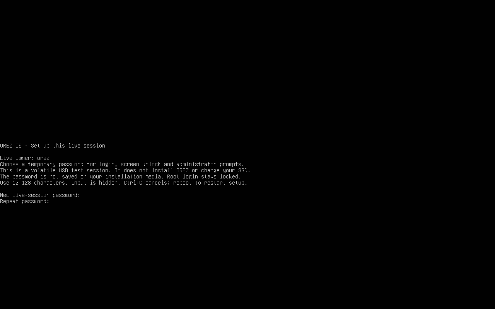
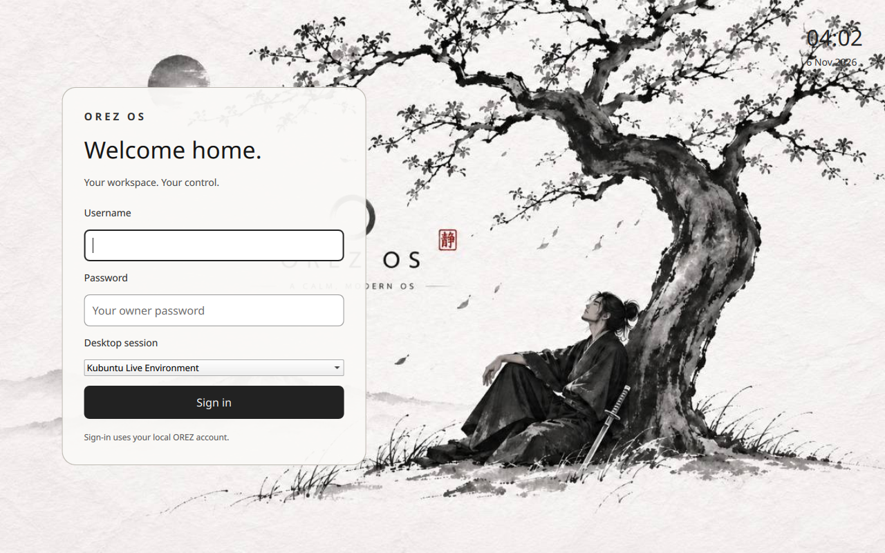
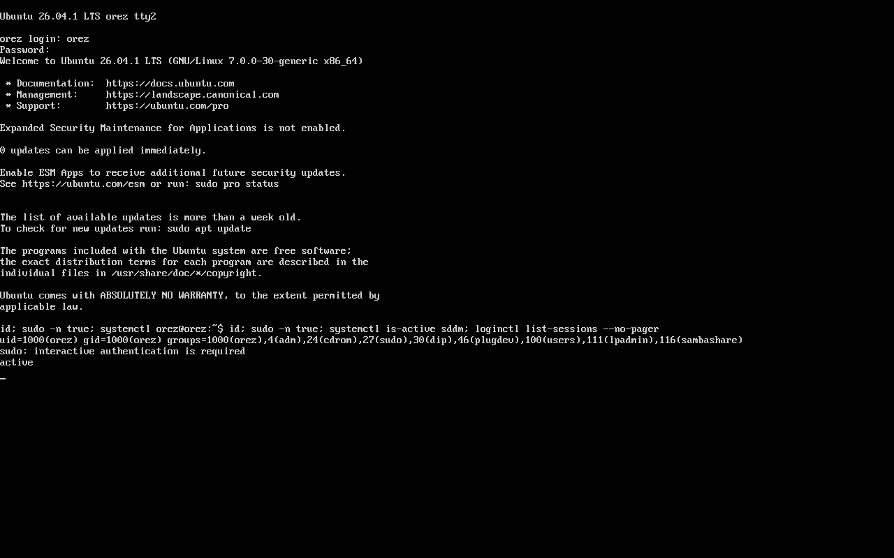
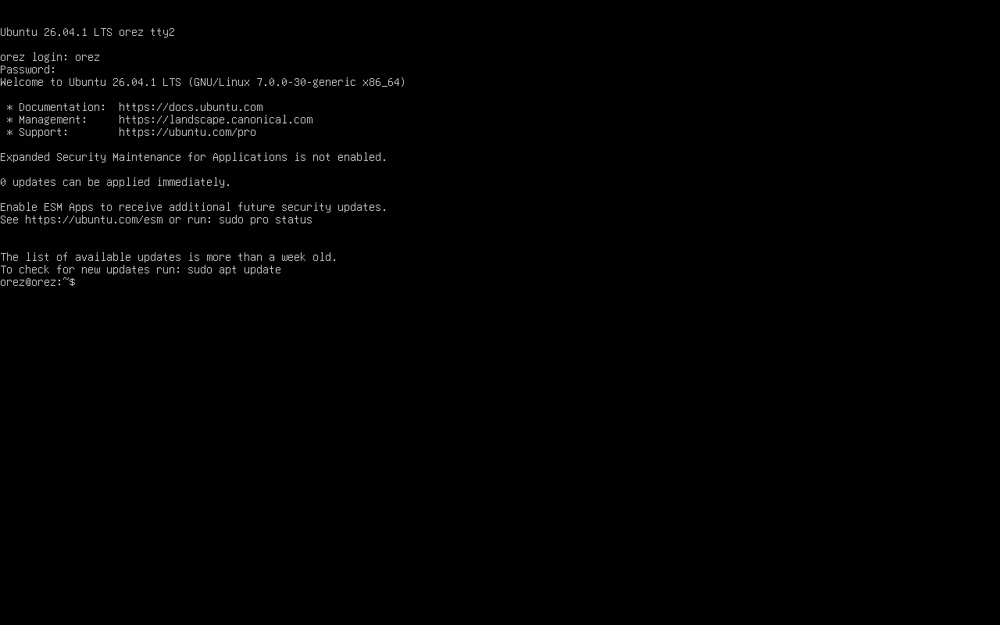

# Actual integrated-image boot tour

These are unaltered guest captures. No usable desktop or installer release is claimed. For every capture and report, extract the archive and open index.html.

## Live account creation, hidden entry

Actual UEFI guest console. The temporary owner password is created locally; no online account is required. Both entries were concealed in this observed console redraw.

## Actual OREZ graphical login

Actual SDDM in the booted ISO, with the approved wallpaper. The initial session label still carries upstream branding. This is a login screen, not the desktop.

## Owner authentication and administrator boundary

Actual owner shell, UID 1000. Passwordless sudo is refused; SDDM is active. This is a scoped authorization check, not a comprehensive security certification.

## Fourth boot owner shell

Despite its historical filename, this is tty2 after successful ordinary owner authentication. Earlier partial captures did not prove a rejected password.

## Desktop remains blocked

The third boot authenticated through SDDM/PAM and started Plasma, but the observed desktop stayed black. This failed observation is retained.

