# Actual boot and installer-preparation tour

These are original guest captures. Read manifest.json for the exact scope, failures and remaining gates. For every report and frame, extract the archive and open index.html.

## Safe stop before reading a password

Actual earlier UEFI boot. Owner setup refused to read a password while the splash process still owned the console.

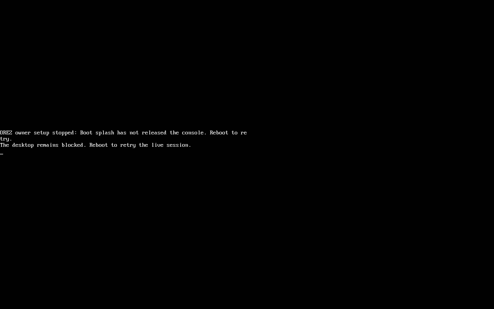

## Local owner creation

Actual diagnostic boot. Both observed enrollment entries are concealed. This temporary account requires no online account and changes no SSD.

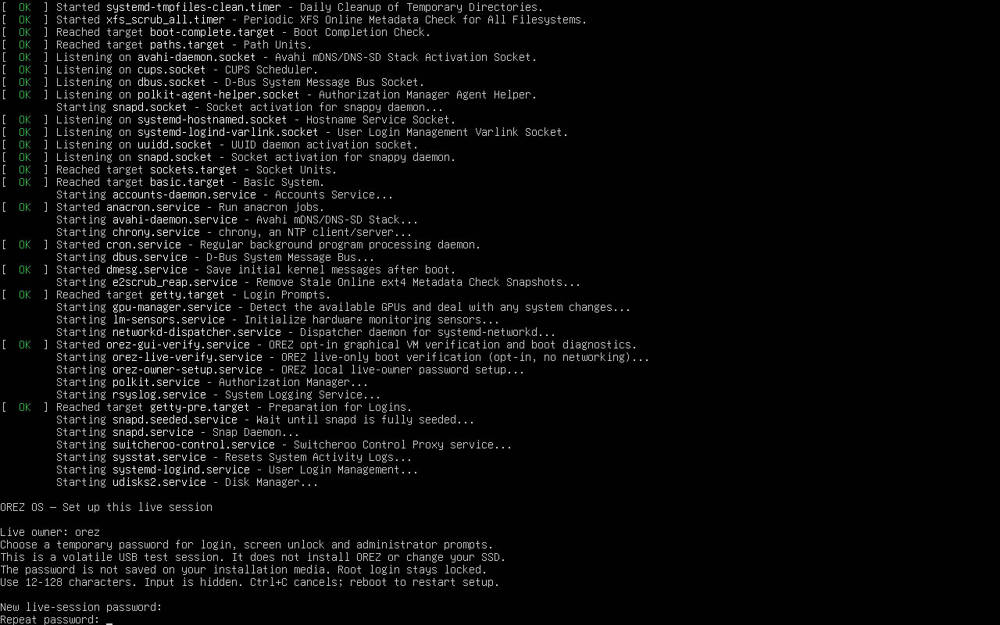

## Owner and administrator boundary

Actual owner shell: UID1000 and passwordless administrator access refused. A scoped check, not complete security certification.

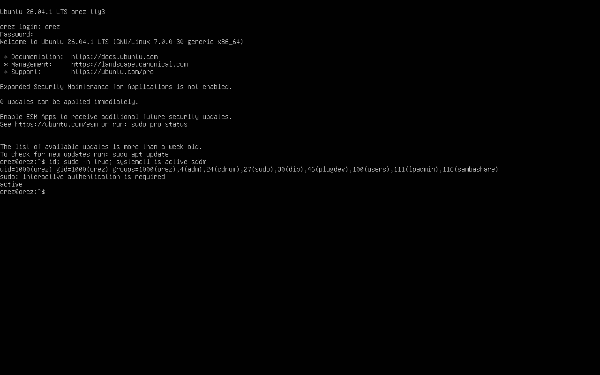

## Actual OREZ login

Actual SDDM in the older booted image, with the approved wallpaper. The inherited live-session selection was subsequently corrected in source.

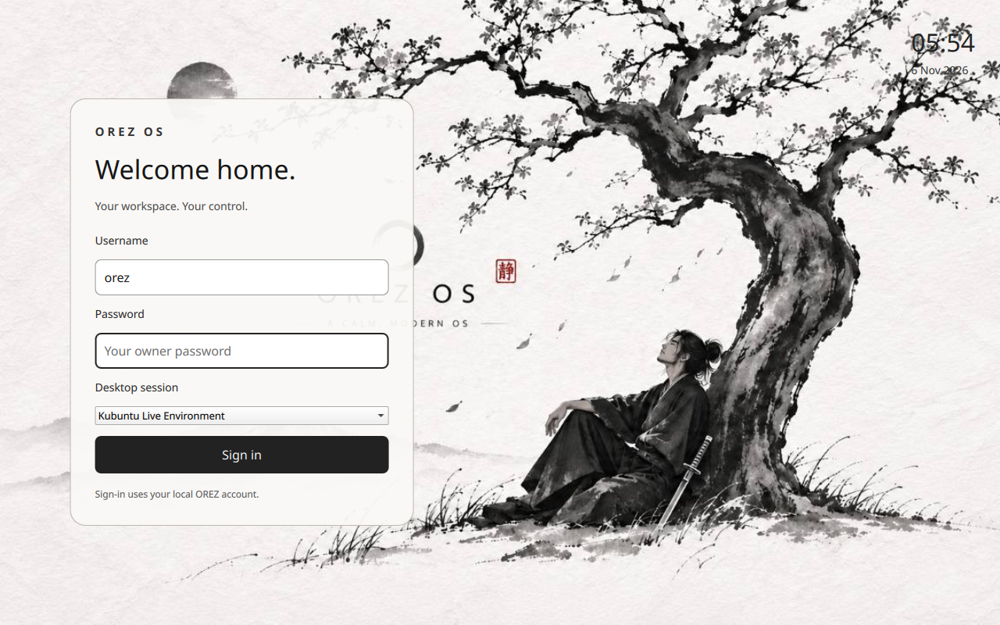

## Incorrect password refused

Despite its historical filename, this frame shows the actual graphical authentication failure message.

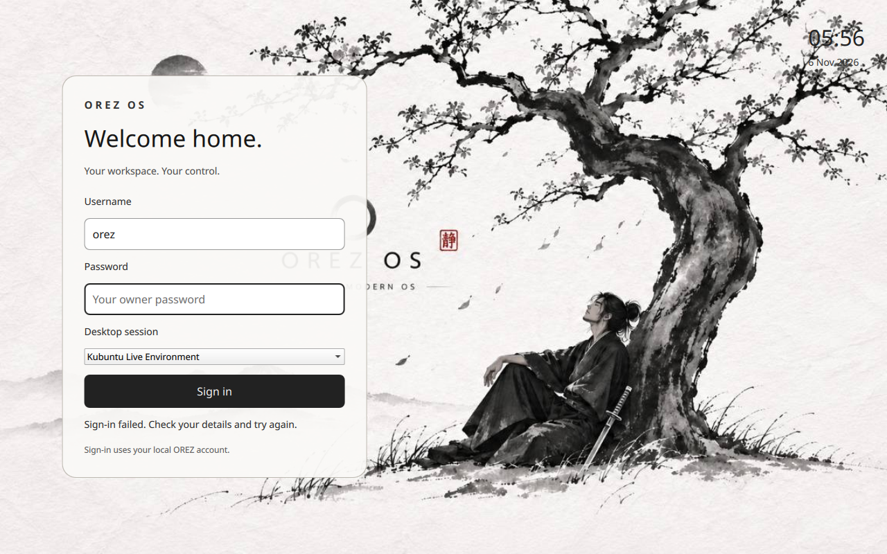

## Inherited startup flow discovered

Correct owner authentication reached the upstream live installer prompt on VT4. The new source uses a direct OREZ desktop entry instead. This is not an installation or desktop pass.

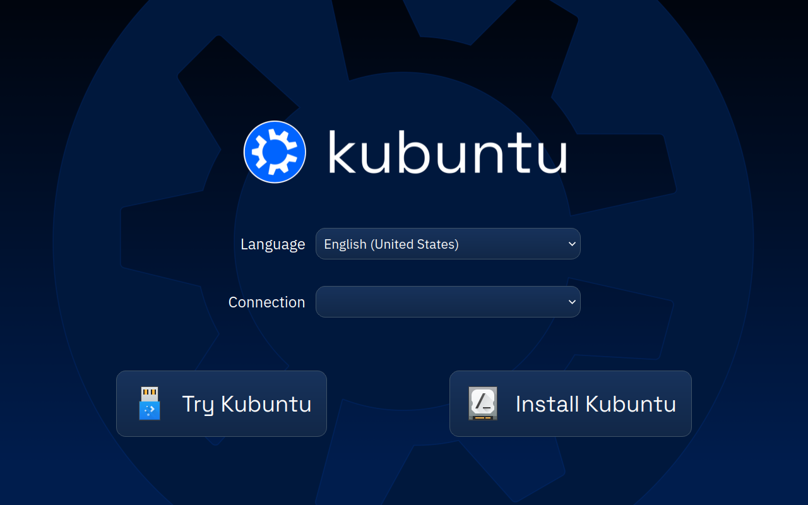

## Corrected image normal boot menu

Actual new-image UEFI menu. Read this run’s diagnostic for the final boot result; a menu is not desktop or installation qualification.

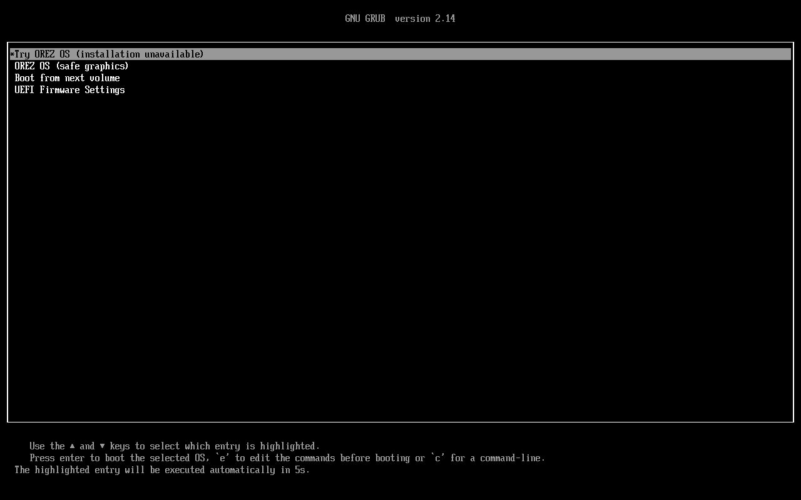

## Normal boot enrollment completed

Actual corrected-image default boot, without edited kernel flags. Both password entries are concealed and enrollment completed. This is one observed timing, not broad race-condition certification.

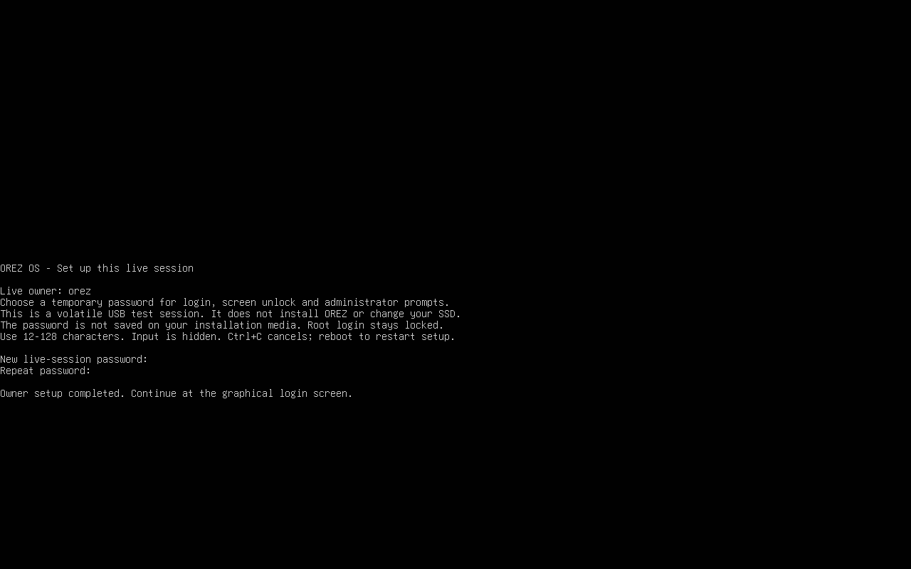

## Corrected OREZ Desktop selection

Actual corrected-image SDDM with approved wallpaper and the dedicated OREZ Desktop entry. Correct authentication succeeded but this normal session then exited64; the desktop below comes from a separate diagnostic.

## Normal-session failure retained

Actual owner-authenticated diagnostic journal shows the normal session ending with exit64. This was not an incorrect-password rejection. Full cause remains unresolved.

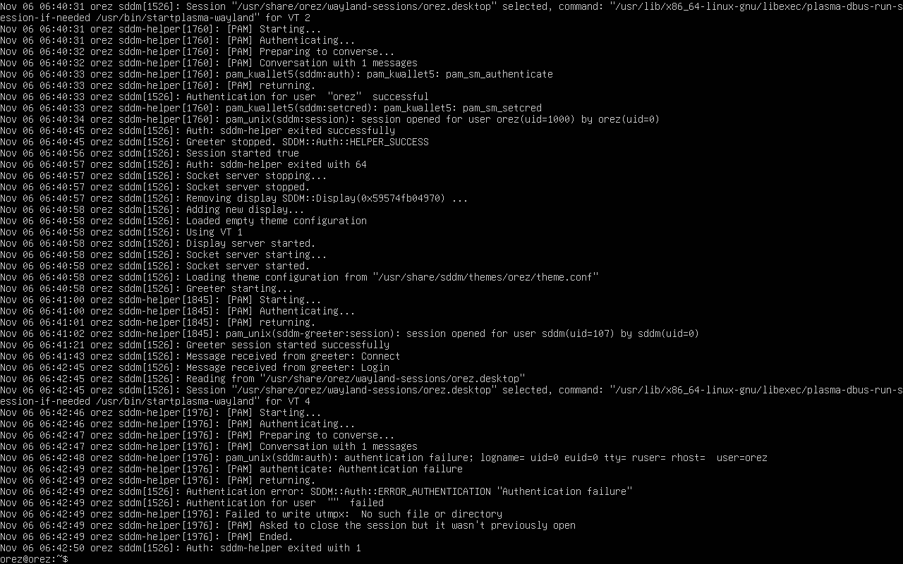

## Separate diagnostic: real native desktop

After the normal-session failure, the already-authenticated ordinary owner launched startplasma-wayland from tty3. This actual booted ISO eventually rendered the approved wallpaper, panel and system tray. Clicking Skip closed Welcome. No root or sandbox bypass; no normal-login or performance pass.

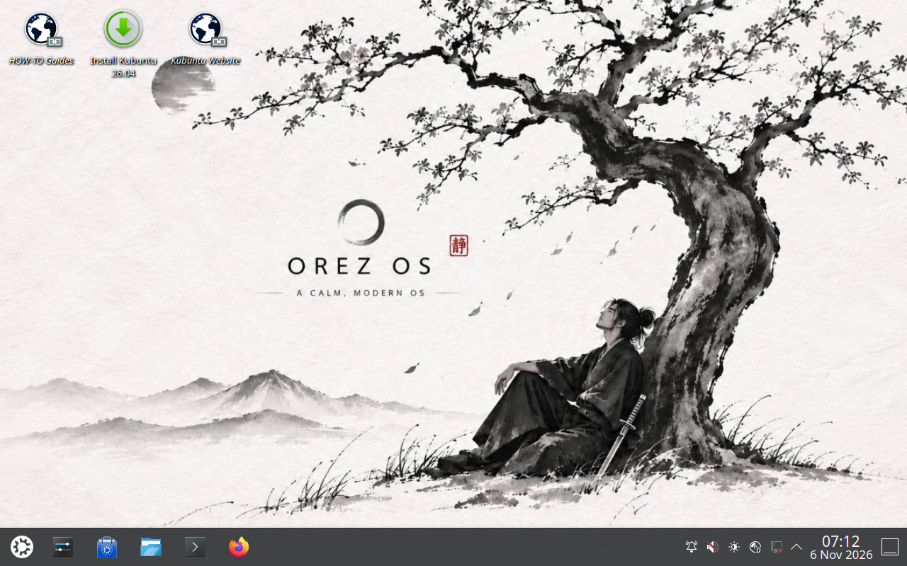

## Separate diagnostic: native Settings opens

Clicking the taskbar Settings icon opened real KDE Quick Settings inside the booted ISO. Search and device/settings routes are visible. No setting was changed, no radio was attached and no network, theme-switching or full settings-functionality pass is claimed. Inherited Kubuntu branding remains.

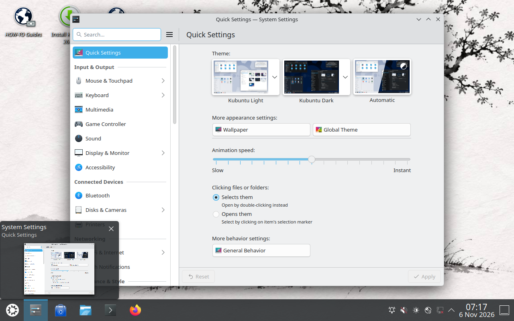
