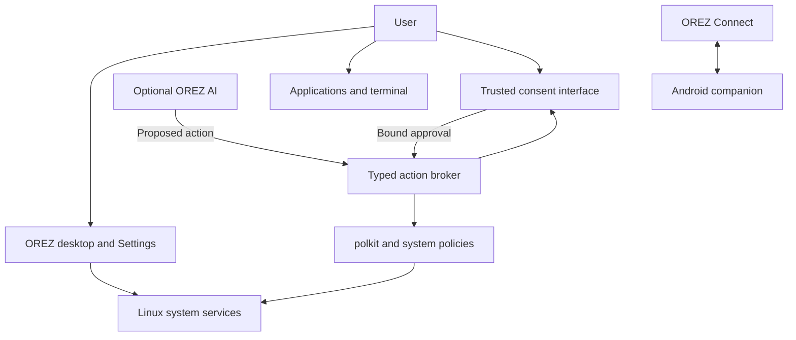

# OREZ OS — Master Engineering Blueprint

**Planning baseline:** 4 November 2026  
**Recommended foundation:** Kubuntu 26.04 LTS, initially qualified against its 26.04.1 amd64 image  
**Primary target:** Your Ryzen 5 5600 / RTX 3050 6 GB desktop  
**Mobile scope:** Android browser preview and native companion, as you selected  
**Current status (5 November 2026):** This is the single engineering blueprint. Source, native packaging, live-ISO construction and a separate phone/browser design preview now exist. Expanded QA has demonstrated a visible native KWin/Plasma desktop in a disposable container, package version transitions, creative/development tools, and 60 passing preview cases. Graphical ISO boot, safe installation, system recovery and physical compatibility remain unqualified. See `QA_SCENARIOS.md` and the current checkpoint in `AI_HANDOFF.md`; do not interpret planned capabilities below as implemented.

## 1. Direction, verified starting point, and release priorities

### 1.1 Product definition

OREZ OS will be a maintained Linux desktop distribution with its own identity, integrated applications, settings, security policies, installation experience, recovery tools, and release process.

It will retain normal desktop capabilities: unrestricted software installation under appropriate permissions, a real terminal, multiple windows and workspaces, development environments, creative applications, gaming, virtualization, and GPU computing.

The engineering strategy is to reuse mature Linux infrastructure and concentrate original development on the parts that make OREZ useful:

- A consistent sumi-e and frosted-glass desktop.
- Searchable, transparent system controls.
- Reliable installation, updates, diagnostics, and recovery.
- Convenient Android integration.
- Optional AI assistance with enforced security boundaries.
- A documented, reproducible development and release process.

OREZ must function fully when AI, phone integration, animations, transparency, and cloud services are disabled.

### 1.2 What has actually been verified

The public repository [RezoxNemesis/OREZ-OS](https://github.com/RezoxNemesis/OREZ-OS) exists.

At the latest repository verification before this session's implementation commit:

| Item | Verified state |
|---|---|
| Default branch | `main` |
| Development branch | `feature/orez-live-foundation-20261104` |
| Starting implementation commit | `27aeece85b8057259ccbaba8abfc455b3bc7c286` |
| Repository contents | Blueprint, required continuity docs, Linux overlay, package/ISO builders and tests |
| Pull request | [#1](https://github.com/RezoxNemesis/OREZ-OS/pull/1), draft and unmerged |
| Prior source CI | [41938523642](https://github.com/RezoxNemesis/OREZ-OS/actions/runs/41938523642), success |
| ISO evidence | Constructed; casper loads OREZ; visible desktop remains unverified |
| Pristine control | Same black desktop in CPU-only QEMU: [41889832695](https://github.com/RezoxNemesis/OREZ-OS/actions/runs/41889832695) |
| Releases | No safe downloadable OREZ installation ISO |
| Original brief | User directive and attached 985-line architecture plan reviewed |

This blueprint is committed project memory. Latest local checks and later commit/CI identities belong in the handoff and session evidence ledger. No APK, physical-device qualification or completed OS is claimed. M1/M2 gates remain open despite passing source and package checks.

### 1.3 Foundation decision

**Select Kubuntu 26.04 LTS with KDE Plasma 6, using Ubuntu’s supported kernel and packaged driver infrastructure.**

The current official image directory provides Kubuntu 26.04.1. Kubuntu documents Plasma 6.6, Wayland as its supported default session, and maintenance through April 2029. OREZ must use that desktop support horizon rather than assume every component receives Ubuntu’s longer base-system coverage. [Official images](https://cdimage.ubuntu.com/kubuntu/releases/26.04/release/), [Kubuntu release notes](https://kubuntu.org/news/kubuntu-26-04-release-notes/).

| Foundation | Assessment for OREZ |
|---|---|
| **Kubuntu 26.04 LTS** | Best initial fit: KDE customization, Ubuntu software ecosystem, packaged NVIDIA installation, and a relatively stable maintenance target. Selected. |
| Debian 13 | Strong derivative infrastructure and stability. Attractive alternative, but its NVIDIA/DKMS integration adds work for this dedicated-GPU target. |
| Fedora KDE / Kinoite | Strong desktop and security foundations. Its approximately 13-month release support window requires more frequent qualification and migration work. |
| Arch-based distribution | Flexible, but continual integration and regression management are a poor initial fit for a small project operated largely from a phone. |

Debian’s live-image tooling remains useful reference material. Fedora Kinoite demonstrates an alternative atomic-update architecture, but OREZ v1 will use conventional package management with tested recovery. [Debian derivatives](https://www.debian.org/derivatives/), [Debian NVIDIA guidance](https://wiki.debian.org/NvidiaGraphicsDrivers), [Fedora Kinoite](https://www.fedoraproject.org/atomic-desktops/kinoite/).

**Redistribution gate:** Canonical’s policy includes requirements concerning modified images, trademarks, and binaries, while preserving applicable open-source licence rights. Before publishing an OREZ ISO, document a compliant redistribution basis for the actual image and its components. Changing the wallpaper and name is insufficient evidence of compliance. If clearance cannot be established, stop public binary publication and revisit the foundation through an architectural decision; do not silently change distributions. [Canonical intellectual-property policy](https://canonical.com/legal/intellectual-property-policy).

### 1.4 Release boundaries

| Stage | Required result |
|---|---|
| **Mobile preview** | A clearly labelled interactive preview of OREZ screens, usable on the Realme phone. |
| **OREZ 0.1 — Functional Alpha** | Bootable USB image, live desktop, graphical installation, working target hardware, security defaults, updates, backup/recovery, basic phone integration. |
| **OREZ 0.2 — Integrated Beta** | More complete design consistency, branded Android companion, improved settings and diagnostics, optional advisory AI. |
| **OREZ 1.0 — Supported Desktop** | Documented hardware support, repeatable installation and recovery, release maintenance, accessibility, and sustained pilot testing. |
| **Later capabilities** | Permission-controlled AI actions, advanced synchronization, remote workflows, verified-boot improvements, and optional atomic deployments. |

AI features are not prerequisites for a reliable 1.0 desktop.

A phone preview does not validate Linux booting, NVIDIA drivers, partitioning, or Secure Boot. Those require separate VM and physical-PC evidence.

---

## 2. System architecture and user experience

### 2.1 Core technology choices

| Layer | Decision |
|---|---|
| Architecture | x86-64 UEFI; GPT for new installations |
| Kernel | Supported Ubuntu generic kernel; no OREZ kernel fork |
| Desktop | KDE Plasma 6, KWin, Wayland, XWayland for compatible legacy applications |
| Login and boot presentation | Packaged SDDM and Plymouth, with OREZ assets |
| Native interface development | Qt 6, QML, Kirigami; C++ for necessary KDE integration |
| New system services | Rust where practical; small, narrowly scoped services |
| System management | systemd, D-Bus, polkit, NetworkManager, UDisks2, UPower |
| Sound | PipeWire and WirePlumber |
| Bluetooth | BlueZ |
| System packages | APT/dpkg with authenticated repository metadata |
| Desktop applications | Native packages, Flatpak, existing Snap support, AppImage, source builds, vendor installers |
| Filesystem | Btrfs for the supported OREZ installation profile |
| Encryption | Optional LUKS2, recommended during installation |
| Snapshots | Snapper with OREZ update/recovery integration |
| Backups | Restic, with a simple OREZ settings interface |
| Installer | Calamares using a versioned OREZ configuration derived from the qualified Kubuntu setup |
| Mobile preview | TypeScript, React, Vite; static PWA |
| Android companion | Maintain a small patch set over KDE Connect Android; preserve upstream licences and protocol compatibility |
| Local AI runtime | Optional `llama.cpp` worker with CUDA support; separate orchestration and authorization services |

Use KDE’s supported extension mechanisms before modifying its core. Maintain original upstream identities and acknowledgements wherever required. KDE documents themes, widgets, and other Plasma extension points suitable for this approach. [KDE Plasma development documentation](https://develop.kde.org/docs/plasma/).

### 2.2 Component relationships



The AI proposes actions. It does not own the approval interface or authorization policy.

### 2.3 Hardware qualification plan

Every component begins as **unverified on your machine**, even where upstream support is documented.

| Component | Expected implementation | Required physical checks |
|---|---|---|
| Ryzen 5 5600 | Linux AMD support, packaged microcode, supported power management | CPU identification, microcode loading, temperatures, load stability, suspend/resume, virtualization |
| MSI B550M PRO-VDH WIFI | Standard UEFI/ACPI platform support | Exact board revision, BIOS version, boot entries, Secure Boot state, USB controllers |
| RTX 3050 6 GB | Ubuntu-packaged NVIDIA desktop driver | Actual PCI ID, module signature, Wayland, Vulkan, CUDA, video acceleration, suspend/resume |
| Intel Wireless-AC 3168, if fitted | `iwlwifi` plus firmware | Actual PCI ID; 2.4/5 GHz, reconnect, Bluetooth coexistence, sustained transfer |
| Bluetooth | `btusb`, firmware, BlueZ | Actual USB ID; mouse/headset pairing, reconnection, audio |
| Realtek 8111HN Ethernet, if fitted | In-kernel `r8169` expected | Actual PCI ID, link negotiation, sustained traffic, resume |
| ALC892/ALC897 audio, if fitted | ALSA HDA plus PipeWire | Rear/front outputs, microphone, HDMI/DisplayPort audio |
| WD Blue SN5000 500 GB | Linux NVMe driver | Exact model and firmware, SMART health, TRIM, thermal behaviour, filesystem checks |
| USB | Linux xHCI and applicable device drivers | Every used port, hubs, storage, phone MTP, boot USB |
| Lenovo 27-inch monitor | NVIDIA display stack and EDID | Exact model, connection, native resolution, refresh rates, scaling, sleep/wake |

MSI documents the Ethernet and audio components and lists AC wireless/Bluetooth capability; its datasheet identifies the standard board’s Intel AC 3168. Board variants must not be confused with the CEC model. Linux documents AC 3168 support in `iwlwifi`. [MSI specifications](https://www.msi.com/Motherboard/B550M-PRO-VDH-WIFI/Specification), [MSI datasheet](https://storage-asset.msi.com/datasheet/mb/in/B550M-PRO-VDH-WIFI.pdf), [Linux wireless documentation](https://wireless.docs.kernel.org/en/latest/en/users/drivers/iwlwifi.html).

The Ryzen 5 5600 requires discrete graphics. Connect the monitor to the RTX 3050, not the motherboard’s video connectors. [AMD processor documentation](https://www.amd.com/en/support/downloads/drivers.html/processors/ryzen/ryzen-5000-series/amd-ryzen-5-5600.html).

Create a read-only diagnostic collector for PCI/USB IDs, kernel, firmware, graphics, storage health, display information, and relevant logs. Redact serial numbers, MAC addresses, usernames, and network details from public reports by default.

Do not flash BIOS or SSD firmware automatically.

### 2.4 NVIDIA and Secure Boot policy

1. Use Ubuntu’s recommended packaged desktop driver through `ubuntu-drivers`.
2. Prefer the distribution’s prebuilt signed modules for the selected kernel.
3. Record the exact kernel, driver, firmware, Vulkan, and CUDA-runtime combination in each release manifest.
4. Include the qualified driver and necessary offline installation packages in the target-hardware image where redistribution permits.
5. Validate accelerated graphics in both the live environment and installed system.
6. If DKMS becomes necessary, use a locally generated Machine Owner Key and an explained, physical-console enrollment process.
7. Never silently disable Secure Boot or install NVIDIA’s `.run` installer over distribution packages.
8. Retain a previous working kernel/driver recovery path.

Ubuntu specifically recommends its packaged drivers and describes prebuilt signed modules as the default supported Secure Boot route. [Ubuntu NVIDIA installation documentation](https://ubuntu.com/desktop/docs/en/latest/how-to/graphics/install-nvidia-drivers/).

Provide explicit boot choices:

- **Try OREZ OS**
- **Try OREZ OS — basic graphics**
- **Check installation media**
- **Recovery tools**

Basic graphics is a troubleshooting mode. Its availability and usability must be tested on the RTX 3050; it is not an assumed escape route.

Wayland is the supported desktop session. An X11 session may remain installable as an advanced compatibility option, with its support and isolation limitations explained.

### 2.5 Visual system

**Identity:** Japanese sumi-e ink painting with restrained frosted-glass interfaces.

The primary wallpaper should depict textured white handmade paper, a large black ink-brushed Japanese tree, and a person in black clothing resting against it. Commission or create assets with recorded rights and provenance.

| Element | Rule |
|---|---|
| Background | Warm paper white, approximately `#F6F4EF` |
| Primary text | Near-black, approximately `#161616` |
| Secondary text | Neutral gray, approximately `#595959` |
| Surfaces | Opaque or lightly translucent white; blur is optional |
| Colour | Predominantly grayscale; restrained semantic colour may distinguish warnings and failures |
| Typography | Noto Sans for interfaces; Noto Sans Mono for code; appropriate multilingual fallbacks |
| Spacing | Consistent 4/8-pixel spacing system |
| Corners | Moderate rounding, generally 8–12 pixels |
| Motion | Short transitions, normally 120–180 ms |
| Contrast | At least 4.5:1 for normal text; 3:1 for large text and necessary interface boundaries |
| Accessibility | Keyboard navigation, visible focus, scalable text, screen-reader labels, reduced motion |
| Low-effects mode | Opaque panels, no blur, minimal animation; identical functionality |

Wallpaper texture must not reduce readability inside application content areas. Interface contrast must be tested against the actual composited background.

Use shared design tokens to generate QML and CSS values. Android follows the same visual rules through native resources; the three platforms do not need to share an entire UI implementation.

### 2.6 Screen architecture

| Surface | Implementation and behaviour |
|---|---|
| Desktop | Plasma workspace, multiple desktops, normal window controls, configurable shortcuts |
| Taskbar | One configurable bottom panel: launcher, running/pinned applications, status area |
| Launcher | Application search, recent items, settings search; KRunner remains available |
| File manager | Dolphin with OREZ defaults and styling; tabs, split views, network locations, permissions |
| Settings | KDE System Settings plus OREZ modules and a unified search index |
| Notifications | Plasma notifications; privacy controls and hidden sensitive content on lock screen |
| AI panel | Optional side panel showing provider, supplied context, active tools, and Stop |
| Login/lock | Consistent wallpaper and typography; legible authentication and accessibility controls |
| Installer | Clear staged flow with a prominent final storage summary |
| Recovery | Plain, dependable interface with diagnostics, backup access, boot repair, and restore |
| Mobile preview | Touch-adapted representations of these screens, explicitly marked as simulations |

The browser preview must never pretend it has installed packages, formatted disks, accessed the PC, or run real diagnostics.

### 2.7 OREZ Connect

Use **KDE Connect as the communication foundation**, wrapped in OREZ onboarding, status, permissions, and diagnostics. Its existing functionality includes file sharing, notifications, battery information, clipboard integration, and remote controls over encrypted connections. [KDE Connect](https://apps.kde.org/kdeconnect/), [upstream Android implementation](https://github.com/KDE/kdeconnect-android).

**First functional release:**

- Guided installation of the upstream KDE Connect Android app.
- LAN discovery and pairing with verification on both devices.
- Pair-verification code support as a qualification requirement.
- Bidirectional file transfer with visible progress and cancellation.
- Battery status, optional notifications, media controls, and phone-as-trackpad.
- Clipboard sharing with explicit enablement and Android-compatible manual sending.
- Per-device permissions, disconnect, forget-device, and revoke-all controls.
- USB MTP transfer through Dolphin when the phone and cable support it.

**Integrated beta:**

- A branded Android companion derived from KDE Connect Android.
- OREZ onboarding, permission explanations, and diagnostics.
- QR-assisted discovery/onboarding, followed by the upstream authenticated pairing flow.
- Visible certificate/device identity and changed-identity warnings.

Do not invent a new cryptographic protocol. KDE’s protocol documentation is not a guaranteed third-party interface, so pin compatible implementations and test interoperability. [KDE Connect protocol reference](https://github.com/KDE/kdeconnect-meta/blob/work/protocol-schemas/protocol.md).

**Security defaults:**

- Connect remains inactive until enabled.
- Discovery is enabled only on a network the user marks trusted.
- Firewall access is scoped to the appropriate interface/network, covering the required KDE Connect ports.
- Each capability is enabled separately; pairing alone does not authorize every plugin.
- Remote-command execution starts disabled.
- Incoming files go to a designated folder, cannot traverse outside it, and never execute automatically.
- Remote input cannot unlock the desktop or approve system/AI authorization dialogs.
- Transfers interrupted by network loss display an honest failure/retry state; resumability is claimed only when implemented and tested.

KDE Connect uses TCP/UDP ports in the 1714–1764 range, and Android clipboard restrictions prevent universal background clipboard synchronization. Do not bypass those restrictions with hidden elevated Android permissions. [KDE Connect user documentation](https://userbase.kde.org/KDEConnect).

**Optional mirroring:** Integrate `scrcpy` as a separately enabled feature. Prefer USB initially. Explain Android debugging authorization and revocation; avoid silently enabling legacy TCP debugging. Wireless debugging is a separate opt-in workflow. `scrcpy` transports video through USB/network connections and does not require USB-C HDMI output. [Official scrcpy project](https://github.com/Genymobile/scrcpy).

**Shared folders and synchronization:** Add later, with folder selection, direction, conflict handling, deletion protection, and version history. Do not ship the discontinued official Syncthing Android app as a maintained dependency; qualify an actively maintained solution before enabling this feature. [Syncthing Android discontinuation](https://github.com/syncthing/syncthing-android).

The Realme’s exact Android/Realme UI version, background-task restrictions, OTG behaviour, and available storage remain qualification inputs.

### 2.8 Applications, gaming, creativity, and development

OREZ Store should initially be a branded Discover experience with source and permission information. It is a convenience, not an installation restriction.

| Workload | Supported direction and limits |
|---|---|
| Everyday work | Browser, LibreOffice, PDF reader, archive tools, media player, screenshots |
| Programming | Git, editors, compilers, language environments, debugging, rootless containers |
| Gaming | Steam/Proton, native games, optional alternative launchers, controller testing |
| Graphics | Krita, GIMP, Inkscape |
| Video/audio | Kdenlive, OBS Studio, Blender, suitable audio tools |
| Animation | Blender, Krita, and optional specialist applications |
| Game development | Godot; optional Unity/Unreal where vendor requirements and resources permit |
| Virtualization | KVM/QEMU and virt-manager after firmware virtualization is verified |
| AI development | CUDA-compatible environments, PyTorch, notebooks, model evaluation and small experiments |

Important boundaries:

- Game compatibility is title-specific. Kernel-level anti-cheat and some DRM remain obstacles; preserve Windows dual boot for incompatible workloads. [Valve Proton guidance](https://partner.steamgames.com/doc/steamhardware/proton).
- Do not promise native Adobe Creative Cloud or universal Windows application compatibility.
- Blender supports NVIDIA CUDA/OptiX rendering, but scene size and GPU memory determine practicality. [Blender rendering documentation](https://www.blender.org/features/rendering/).
- With 16 GB RAM, start with one VM using roughly 4–6 GB, not several large VMs.
- The sole GPU is needed by the desktop. GPU passthrough is an advanced future configuration, not a supported v1 default.
- Large engines, games, datasets, and models can quickly exhaust the 500 GB SSD.

Keep heavyweight development, creative, and AI environments out of the default ISO. Offer removable, documented installation profiles.

### 2.9 AI feasibility on the actual hardware

The RTX 3050 6 GB is an Ampere GPU with CUDA compute capability 8.6. This enables useful local inference and development, but does not imply large-model training capacity. [NVIDIA RTX 3050 specifications](https://www.nvidia.com/en-gb/geforce/graphics-cards/30-series/rtx-3050/).

**Initial supported AI profile:**

- One local inference worker at a time.
- A small, licensed 1–3B-class quantized model as the first benchmark target.
- CPU fallback and partial GPU offload.
- Explicit context-length and memory limits.
- No automatic model download.
- Model size, licence, origin, checksum, storage usage, and estimated memory shown before installation.
- No model-supplied code execution by default.

A 7–8B quantized model may be usable with constrained context or CPU offload, but is not a guaranteed fully GPU-resident experience on a 6 GB display GPU.

Small training exercises and carefully selected parameter-efficient fine-tuning can be qualified later. Large-model training from scratch and general-purpose large-model fine-tuning are outside this hardware’s practical scope.

Use isolated project environments for CUDA/PyTorch. Avoid toolkit installations that replace the working host graphics driver. Record compatible driver/toolkit/framework combinations rather than assuming the newest versions work together. [NVIDIA CUDA installation guide](https://docs.nvidia.com/cuda/cuda-installation-guide-linux/index.html).

OREZ resource management should warn before overcommit, pause optional inference when requested, and keep a usable desktop. Consumer GPU memory budgeting is advisory/application-enforced; do not represent it as hardware partitioning.

---

## 3. Security, transparent control, installation, and recovery

### 3.1 Threat model

Protect user files, credentials, encryption keys, software integrity, device-pairing keys, release-signing keys, and recovery capability.

| Threat | Main controls | Remaining limitation |
|---|---|---|
| Malicious applications | Sandboxing, portals, least privilege, trusted package sources | An application granted broad file access can damage those files |
| Ransomware | Restricted access, snapshots, versioned disconnected backups | Root compromise or an attached writable backup can defeat local protections |
| Unauthorized remote access | Firewall, disabled remote services, authenticated pairing | Explicitly enabled remote services introduce additional attack surface |
| AI prompt injection | Separate identities, capability broker, approvals, restricted tools | Users can still be deceived into authorizing harmful actions |
| Supply-chain compromise | Pinned inputs, authenticated repositories, signatures, review, provenance | A trusted upstream or signing system can still be compromised |
| Malicious USB | USB authorization, no autorun, controlled mounting | Device identity can be spoofed; hardware/firmware attacks remain possible |
| Privilege escalation | Updates, AppArmor, service confinement, minimal privileged code | Kernel and driver vulnerabilities remain relevant |
| Theft or physical access | Encryption, screen lock, boot-chain protections | Unlocked devices and boot-component tampering require additional defences |

No absolute-security claim is permitted.

### 3.2 Default security posture

- Normal installed sessions run without root privileges.
- Direct root login is locked by default.
- The owner can administer the machine through visible, authenticated controls.
- AppArmor remains enabled; new OREZ services receive tested profiles.
- Firewall policy denies unsolicited inbound traffic for IPv4 and IPv6.
- SSH server, remote desktop, file-serving daemons, and AI network listeners start disabled.
- Rootless containers are preferred; Docker socket access is treated as powerful host access.
- Flatpak applications use portals and minimum permissions.
- Native packages and AppImages remain installable, with their broader trust implications explained.
- Automatic execution from removable media is disabled.
- No default cloud telemetry or automatic diagnostic uploads.
- Persistent full-memory crash dumps are opt-in because they can contain secrets.

Flatpak isolation depends on its granted permissions; broad home-directory, device, and bus access can weaken it substantially. [Flatpak permission documentation](https://docs.flatpak.org/en/latest/sandbox-permissions.html).

USBGuard should be integrated with visible authorization controls. Enroll the known keyboard, mouse, and internal devices before enforcing a blocking policy, and test a local recovery route to prevent input lockout. USBGuard does not protect the earlier firmware stage. [USBGuard configuration](https://usbguard.github.io/documentation/configuration).

### 3.3 AI permission architecture

The model runtime must be treated as untrusted software.

**Process separation:**

- Inference workers run under a separate unprivileged identity or equivalently enforced sandbox.
- Workers have no general access to the user’s home, credential store, session bus, terminal, or desktop input.
- Local inference has no network access by default.
- Cloud-provider adapters receive only the explicitly supplied context and provider-specific credentials.
- Tool adapters run separately with narrow filesystem and network access.
- The privileged system helper contains no model logic and accepts no arbitrary shell command.
- MCP tools and external responses cannot modify authorization policy.

**Permission classes:**

| Action | Required authority |
|---|---|
| Read public system status | Allowlisted, non-sensitive status interface |
| Read selected user documents | User-selected files/folders; scoped, revocable grant |
| Edit a project | Explicit workspace grant; visible diff and recovery path |
| Send data to a cloud provider | Provider enablement plus clearly described data scope |
| Run development commands | Approved sandbox/workspace, resource limits, controlled network access |
| Change system settings or install packages | Bound user consent and normal administrator authentication |
| Partition disks, change boot trust, access recovery secrets | Dedicated local administrative workflow; no autonomous AI execution |

A persistent permission must always specify its scope and remain visible in Settings. “Allow AI everything” is not a supported policy preset.

**Sensitive-action flow:**

1. An adapter proposes a typed operation.
2. The broker validates the caller using operating-system identity, not self-reported JSON.
3. The broker constructs a preview of the exact effects.
4. A trusted local interface shows origin, affected resources, risk, and available recovery.
5. The user approves that operation; polkit authenticates when necessary.
6. The helper revalidates the operation and target immediately before execution.
7. Execution produces an audit event and a clear result.

Approvals are single-use, short-lived, and bound to the operation’s parameters. Changed parameters require renewed consent. Sensitive operations must not reuse broad cached administrative authorization. polkit’s own documentation explains why retained authorization requires care when action parameters differ. [polkit reference](https://www.freedesktop.org/software/polkit/docs/latest/polkit.8).

**Emergency stop:**

- Always-visible Stop control while automation is active.
- A configurable global shortcut.
- An independent `orezctl automation stop` command.
- Revoke outstanding grants, stop tool processes, close their channels, and request cancellation of cloud jobs.
- Keep automation stopped until the user explicitly re-enables it.

Stopping automation cannot undo already completed external actions. The interface must distinguish cancellation, successful termination, and actions that already occurred.

### 3.4 Initial internal interfaces

Version OREZ-owned interfaces from their first implementation.

| Interface | Purpose |
|---|---|
| `org.orez.Settings1` | Settings metadata, effective values, validation, and reset information |
| `org.orez.SystemActions1` | Narrow privileged operations mediated by polkit |
| `org.orez.Connect1` | Device status, capability permissions, transfers, revocation |
| `org.orez.AI1` | Provider status, inference sessions, action proposals, cancellation |
| `orezctl` | Documented CLI equivalents for supported OREZ operations |

D-Bus is the default desktop transport. Do not expose these services through an unauthenticated local web server.

System changes use a common conceptual sequence: **inspect → propose → authorize → apply → report → revert where supported**. Long-running jobs expose progress and cancellation. Security-sensitive backends fail closed if authorization services are unavailable.

### 3.5 Central Settings contract

Build on KDE System Settings, adding OREZ modules rather than creating a competing configuration system.

Every significant OREZ feature must register:

- Searchable name and settings location.
- Purpose and current status.
- Requested and effective configuration.
- Owning service or upstream configuration source.
- Permissions and security implications.
- Enable/disable or configuration controls.
- Whether a restart or reboot is required.
- Reset/rollback behaviour and its limitations.
- Relevant logs and diagnostics.

| Settings area | Required controls |
|---|---|
| Appearance & Accessibility | Wallpaper, contrast, blur, motion, fonts, scaling, shortcuts |
| Network & Internet | Wi-Fi, Ethernet, VPN, DNS, firewall profiles, sharing |
| Devices | Displays, GPU driver status, Bluetooth, audio, USB authorization |
| Apps & Permissions | Package sources, application permissions, defaults, startup items |
| Phone & Sharing | Pairing, devices, capability permissions, transfers, mirroring, revocation |
| AI & Automation | Providers, models, tools, grants, context, resource budgets, emergency stop |
| Security & Privacy | Authentication, encryption status, Secure Boot status, logs, telemetry |
| Storage & Backup | Disk health, space, snapshots, backup destinations, restore |
| Updates & Recovery | Channels, schedules, pending changes, retained kernels, repair |
| Advanced & Diagnostics | Services, effective configuration, overrides, troubleshooting exports |

External CLI changes must be reflected accurately. OREZ must not silently overwrite them; report conflicts and explain which subsystem owns the setting.

Critical controls may require authentication or a reboot. Unsupported overrides remain documented and visible rather than being hidden behind unexplained restrictions.

### 3.6 Storage and encryption

For a **new installation into explicitly approved space**, use:

| Area | Proposed layout |
|---|---|
| EFI System Partition | 1 GiB FAT32 on a new disk; carefully reuse an existing suitable ESP without formatting |
| `/boot` | 2 GiB ext4, outside the encrypted root |
| System/data | LUKS2 containing Btrfs when encryption is selected |
| Root subvolume | OS, `/etc`, and package-management state together |
| Separate subvolumes | Home, snapshots, logs, caches, and designated large workload data |
| Memory pressure | zram initially; hibernation disabled until a separately tested encrypted-swap configuration exists |

Use LUKS2 with a strong passphrase and normal modern key derivation. Keep the bootloader outside the encrypted root so the initial design does not depend on GRUB unlocking that LUKS configuration.

The installer must explain that the ESP and `/boot` remain unencrypted. Encryption protects data at rest; it does not protect an already unlocked system.

**Secure Boot limitation:** The conventional Ubuntu chain authenticates signed boot components and kernel modules, but its documentation explicitly notes that traditional initrd images are not validated. OREZ v1 must not claim complete authenticated boot or root-filesystem verification. Signed unified kernel images and stronger measured-boot arrangements are a later, separately qualified improvement. [Ubuntu Secure Boot documentation](https://documentation.ubuntu.com/security/security-features/platform-protections/secure-boot/).

For storage planning, treat the 500 GB drive as approximately 466 GiB before existing partitions and filesystem overhead. Recommend at least 100–120 GiB for a useful OREZ allocation when dual booting, with additional space for games, models, and creative work. The actual allocation is chosen only after inspecting the existing disk.

### 3.7 Updates and rollback

Use separate update paths for:

- Ubuntu base packages.
- OREZ packages.
- Flatpak applications.
- Snap applications.
- Optional development environments and AI models.

Display all sources and their effective schedules.

**Default policy:**

- Check for updates daily.
- Permit configurable automatic security updates.
- Schedule kernel/driver changes for a visible maintenance window.
- Never force an unexpected reboot.
- Retain at least two known working kernel generations.
- Create a pre-update system snapshot and record the package transaction.
- Validate available space and package-manager state before updating.
- Run post-update health checks and report failures.

Snapshots must include the package database together with the corresponding system files. Boot files require a separate matching manifest and recovery procedure.

Root snapshot restoration must preserve user files, logs, pairing revocations, and the automation-disabled state. Keep critical revocation state outside ordinary system rollback; require re-pairing if credentials and revocation records become inconsistent.

Snapper requires a correctly configured Btrfs layout; simply installing it does not create dependable rollback. [Snapper documentation](https://snapper.io/manpages/snapper.html).

A snapshot is not an atomic-update guarantee and is not a backup. Power interruption during APT operations must be tested and supported by recovery procedures.

### 3.8 Backups and incident recovery

Provide encrypted Restic backups to a user-selected external drive. Remote destinations are optional.

Initial suggested retention: seven daily, four weekly, and three monthly backups, adjustable in Settings.

Required behaviours:

- Show last successful backup and last successful restore test.
- Explain excluded folders and large model/game caches.
- Warn when the backup destination is unavailable.
- Keep recovery credentials outside the only computer being protected.
- Recommend a disconnected copy that ransomware cannot continuously access.
- Preserve data versions rather than treating synchronization as backup.

Incident workflow:

1. Stop automation and disconnect affected network services.
2. Preserve relevant logs without exporting secrets.
3. Revoke affected device sessions and tokens.
4. Boot trusted recovery media when host compromise is suspected.
5. Restore or reinstall from verified media.
6. Restore checked user data.
7. Rotate compromised credentials from a trusted device.

Do not assume restoring a system snapshot removes every persistence mechanism after administrator compromise.

### 3.9 Safe installation

The installer’s default path is **Try OREZ OS**.

Installation follows:

1. Language, keyboard, accessibility.
2. Hardware, firmware, power, and storage checks.
3. Backup and Windows recovery-key reminder.
4. Installation mode selection.
5. Explicit target disk/space selection.
6. Partition preview.
7. Encryption and recovery information.
8. User account creation.
9. Driver information.
10. Final irreversible-action confirmation.
11. Installation and post-install verification.

**Mandatory safeguards:**

- No disk is preselected for erasure.
- Identify disks using model, capacity, and stable device identity.
- Show every partition that will be created, formatted, preserved, or removed.
- Revalidate the disk and partition plan immediately before writing.
- Stop if device identities or the storage layout changed.
- Keep cancellation safe until the destructive phase begins.
- Never treat an AI approval, workflow input, or remembered preference as confirmation to erase a disk.

Calamares provides configurable partitioning and encryption facilities, but OREZ’s exact configuration requires its own tests. [Calamares partition configuration](https://github.com/calamares/calamares/blob/calamares/src/modules/partition/partition.conf).

**Dual boot:** Initially support installation into space already made unallocated through Windows’ own tools. Preserve Windows, its recovery partitions, and its boot entry. Require BitLocker recovery information and account for Fast Startup/hibernation before accessing Windows filesystems. Automatic shrinking of arbitrary existing partitions is outside the first supported path.

**Live-session transparency:** Clearly label the live environment’s temporary recovery/administrative capabilities. Disable remote administration. Installed systems must not inherit live users, permissive sudo rules, machine identities, or pairing keys.

### 3.10 Android-friendly ISO workflow

Use a **separate, clearly labelled USB drive**, preferably 16 GB or larger. Physically set aside the Windows recovery/installation USB.

The documented phone workflow will be:

1. Open the verified OREZ release page.
2. Download the ISO, signed checksum manifest, and signature.
3. Verify the signing-key fingerprint against a previously trusted record.
4. Verify the signature and ISO SHA-256 locally.
5. Connect the separate USB drive through a compatible OTG adapter.
6. Use EtchDroid to write the hybrid image after confirming the USB device.
7. Complete write verification and safely disconnect.
8. If Android offers to format the freshly written drive, decline.
9. Boot the PC’s UEFI USB entry and run media verification before trying installation.

EtchDroid supports writing Linux disk images without Android root; Android may not recognize the resulting filesystem. It is not the recommended tool for rewriting your existing Windows recovery USB. [EtchDroid](https://etchdroid.app/), [EtchDroid FAQ](https://etchdroid.app/faq/).

Initially, provide illustrated Termux verification instructions. Later, the companion can verify signed manifests and large files through a native file picker. The public PWA is not a trusted ISO-writing or privileged verification service.

If the phone cannot reliably power or access the USB drive, use the existing Windows installation to write the separately verified OREZ image.

---

## 4. Engineering, build infrastructure, roadmap, and release gates

### 4.1 Repository structure

Use a modular monorepo:

```text
OREZ-OS/
├── AGENTS.md
├── README.md
├── docs/
│   ├── MASTER_BRIEF.md
│   ├── ARCHITECTURE.md
│   ├── ROADMAP.md
│   ├── HARDWARE.md
│   ├── SECURITY.md
│   ├── DESIGN_SYSTEM.md
│   ├── BUILD_AND_RELEASE.md
│   ├── INSTALL_AND_RECOVERY.md
│   ├── DECISIONS.md
│   ├── KNOWN_ISSUES.md
│   ├── AI_HANDOFF.md
│   └── MASTER_BLUEPRINT.md
├── desktop/          # Plasma, login, boot and design assets
├── apps/             # Welcome, settings modules, diagnostics
├── services/         # Typed brokers and system integrations
├── ai/               # Providers, inference and restricted tools
├── connect/          # Desktop adapters and Android patch set
├── preview/          # Mobile-friendly PWA
├── packaging/        # Debian packages and repository metadata
├── image/            # ISO manifests, overlays and installer config
├── build/            # Reproducible build entrypoints
├── tests/            # Unit, integration, VM and hardware procedures
├── security/         # Policies, threat cases and release key metadata
├── licenses/         # Component licences and attribution
└── .github/          # Workflows, templates and ownership rules
```

The requested topic documents are canonical for their subjects. Generate `MASTER_BLUEPRINT.md` from them as the single consolidated reading artifact; do not maintain conflicting manual copies.

Keep binaries, models, ISOs, large test videos, and credentials out of Git.

### 4.2 Engineering standards

- Make changes through focused branches and reviewable pull requests.
- Require relevant checks before merge.
- Apply ownership rules to workflows, signing, installer, security policy, and privileged code.
- Use separate review for changes to authorization, partitioning, boot, or release signing.
- Where only one maintainer exists, document the review limitation instead of claiming independent review.
- Pin dependencies and record upstream versions and licences.
- Use standard formatters, static analysis, and compiler warnings.
- Validate external input at service boundaries.
- Keep privileged operations small and structured; do not build shell commands from untrusted text.
- Make configuration migrations versioned and recoverable.
- Add a settings entry, diagnostics, removal/reset behaviour, and documentation with each significant feature.
- Test behaviour and security boundaries, not merely implementation details.

Security testing should include negative cases: unauthorized callers, invalid inputs, expired grants, missing authentication services, corrupted packages, and interrupted operations.

### 4.3 ISO construction

For the initial implementation, use a **scripted, declarative transformation of a verified official Kubuntu image**, packaged as a reproducible build process.

1. Verify the upstream image signature and checksum.
2. Pin the source ISO digest, build environment, package snapshot, and OREZ commit.
3. Extract the live filesystem in an isolated build VM.
4. Install OREZ `.deb` packages and declared configuration.
5. Apply the qualified Calamares profile and branding.
6. Remove build credentials, machine IDs, logs, and generated device identities.
7. Regenerate the live-filesystem manifests, initramfs where required, and media checksums.
8. Rebuild the SquashFS and hybrid ISO deterministically.
9. Preserve and inspect the upstream signed EFI boot components.
10. Test the rebuilt image from both virtual optical media and a USB-style block device.

Use `xorriso` to reconstruct the image and explicitly verify its boot metadata. Ubuntu’s snapshot service can freeze archive inputs; deterministic timestamps and image metadata require additional control. [Ubuntu snapshot service](https://snapshot.ubuntu.com/), [xorriso documentation](https://www.gnu.org/software/xorriso/man_1_xorriso.html).

For reproducibility:

- Fix timestamps through `SOURCE_DATE_EPOCH`.
- Normalize ordering, ownership, locale, and generated metadata.
- Lock package versions and archive digests.
- Keep signing separate from deterministic payload generation.
- Perform two clean builds from the same locked inputs.
- Compare hashes and investigate differences with `diffoscope`.

Call a build **repeatable** until byte-for-byte reproducibility has been demonstrated. Public stable releases require documented reproducibility results, not a claim based solely on using a build script.

Installed machines must use maintained update sources; do not leave them permanently pinned to the historical build snapshot.

### 4.4 Efficient GitHub Actions

Use a small workflow set:

| Workflow | Trigger | Work |
|---|---|---|
| `validate` | Pull requests | Changed-component builds, linting, documentation/schema checks, unit/security tests |
| `image-candidate` | Manual dispatch or approved candidate tag | Full image build and VM qualification |
| `release` | Protected release action | Verify approved artifacts, sign/promote, publish metadata |
| `maintenance` | Weekly | Grouped dependency updates, vulnerability reports, link/source checks |

Operational rules:

- Path filters prevent documentation changes from rebuilding an ISO.
- Cancel superseded validation runs.
- Batch dependency updates.
- Cache bounded package/compiler inputs by lockfile digest.
- Keep ordinary artifacts briefly; preserve final evidence with releases.
- Avoid nightly full builds until justified.
- Publish concise workflow summaries usable from an Android browser.
- Never execute untrusted pull-request code with release secrets or on the physical desktop.

GitHub’s standard public Linux runners currently document 14 GB of SSD storage. Full ISO construction cannot assume that capacity is enough. Use hosted runners for lightweight jobs; use an isolated, ephemeral x86-64 build VM for full images, provisioned with at least 8 GB RAM and 100 GB working storage. It may run on existing owned hardware or an explicitly provisioned remote host. Its availability is an infrastructure prerequisite, not an existing resource. [GitHub runner specifications](https://docs.github.com/en/actions/reference/runners/github-hosted-runners).

Standard public-repository compute is currently free, but storage and other usage remain separate considerations. Configure budgets before enabling paid infrastructure. [GitHub Actions billing](https://docs.github.com/en/billing/concepts/product-billing/github-actions).

### 4.5 Release integrity and distribution

Every release must include:

- ISO and SHA-256 digest.
- Signed checksum manifest.
- Exact source commit and build-input manifest.
- Package inventory and software bill of materials.
- Build provenance.
- Test report with VM and physical-hardware results separated.
- Known issues and recovery instructions.
- Source/licence material required by redistributed components.
- Android APK certificate fingerprint when an APK is published.

Use separate signing material for package metadata, release manifests, and Android applications. Keep recovery copies offline and document rotation/revocation.

Pin GitHub Actions to reviewed full commit SHAs, minimize token permissions, and isolate signing from untrusted build execution. Provenance must be verified during promotion, not merely generated. [GitHub Actions security guidance](https://docs.github.com/en/actions/how-tos/secure-your-work), [artifact attestations](https://docs.github.com/en/actions/how-tos/secure-your-work/use-artifact-attestations).

**Large-image delivery:** GitHub currently limits each release asset to less than 2 GiB; the upstream Kubuntu image is already larger. Provide a single ISO through HTTPS object storage as the primary user download. Use Cloudflare R2 as the planned storage adapter, with provisioning and cost configuration handled before release. GitHub Releases remains the metadata/source entrypoint. [GitHub release limits](https://docs.github.com/en/repositories/releasing-projects-on-github/about-releases).

For a zero-additional-hosting development fallback, publish numbered chunks below the limit and a signed reconstruction manifest with documented Termux instructions. Treat this as a less convenient fallback, not the default mobile experience.

### 4.6 Licensing and dependency maintenance

Original OREZ code and artwork currently remain reserved to the project owner, consistent with the repository README; no blanket open-source licence has been granted. Select an explicit compatible licence before public binary distribution. Preserve upstream licensing for modified KDE, React, Vite and other third-party components; original-code ownership never overrides dependency obligations.

For each shipped component, track:

- Upstream project and version.
- Licence expression.
- Modifications.
- Corresponding-source obligations.
- Redistribution restrictions.
- Security-update owner.
- End-of-support information.

Keep notices and corresponding sources accessible. A public GitHub repository alone does not satisfy every redistribution obligation.

If future original components remain proprietary, isolate them where licensing permits and review their interfaces and dependencies. Do not assume linking a proprietary component to GPL code is permissible. [GNU licensing FAQ](https://www.gnu.org/licenses/gpl-faq.en.html).

Review NVIDIA redistribution terms, fonts, wallpaper rights, codecs, model licences, application stores, and trademarks independently.

Maintenance must cover the whole delivered system:

- Monitor Ubuntu security notices, KDE advisories, NVIDIA bulletins, and OREZ dependency advisories.
- Track fixes for modified packages; upstream updates may not automatically repair a fork.
- Triage active exploitation and critical vulnerabilities promptly.
- Publish mitigations and affected-version information when a fix is unavailable.
- Plan migration before the desktop foundation reaches end of support.
- Never advertise maintenance longer than the team can provide.

### 4.7 Milestone roadmap

Estimates are focused engineering effort, not guaranteed dates. Hardware access, build infrastructure, and defects determine elapsed time.

| Milestone | Deliverable | Exit condition | Indicative effort |
|---|---|---|---|
| **M0 — Project foundation** | Requirements, ADRs, repository rules, tokens, small mobile preview | Documents agree; preview works on the Realme and is labelled simulated | 1–2 weeks |
| **M1 — Bootable baseline** | Locked base, image pipeline, plain OREZ live desktop | Repeatable UEFI VM boot and recorded build inputs | 2–3 weeks |
| **M2 — Installation and recovery** | Calamares profile, encryption, snapshots, updates, restore | Disposable-disk installation and failure-recovery suite passes | 4–6 weeks |
| **M3 — Target hardware** | NVIDIA/Secure Boot and peripheral qualification | Exact PC passes the hardware matrix; unresolved failures are documented | 2–4 weeks |
| **M4 — Functional Alpha 0.1** | Settings, backup UI, basic Connect, signed candidate | Full alpha gate passes; public publication additionally passes licensing gate | 3–5 weeks |
| **M5 — Integrated Beta 0.2** | Branded companion, design consistency, accessibility, optional advisory AI | Permission, mobile, performance, and regression tests pass | 4–8 weeks |
| **M6 — Desktop 1.0** | Maintenance-ready release and user documentation | Thirty-day pilot, successful restore drill, no release-blocking defects | 4–8 weeks |

A focused experienced maintainer should plan in months. A dependable 1.0 may reasonably require roughly 6–12 months or longer, particularly with part-time work.

Advanced AI actions follow their own threat review and test gate after the underlying desktop is dependable.

### 4.8 Measurable release acceptance

Every result records the commit, artifact digest, environment, procedure, outcome, and evidence.

| Area | Acceptance requirement |
|---|---|
| Build integrity | All input signatures/digests verified; corrupted input rejected; no embedded secrets |
| Reproducibility | Two clean builds compared; byte differences resolved before claiming reproducibility |
| UEFI boot | VM boots with Secure Boot enabled and disabled; invalid test boot binaries are rejected |
| Installation | Blank virtual disk, encrypted install, unencrypted install, and prepared-space dual boot pass |
| Data preservation | Cancellation leaves disks unchanged; non-target disk content remains unchanged; Windows recovery partitions are preserved |
| Recovery | Failed package transaction, failed graphics update, and root rollback recover through documented procedures |
| Physical boot | Twenty consecutive boot/reboot cycles without unexplained boot failure |
| Power management | Ten suspend/resume cycles with display, network, audio, and input restored |
| Graphics | Correct driver loaded; Vulkan and CUDA checks pass; one-hour graphics/compute workload produces no unexplained GPU reset |
| Network | Ethernet/Wi-Fi transfer and reconnect tests pass; Bluetooth coexistence is recorded |
| Phone integration | Repeated pairing/revocation passes; 1 GiB bidirectional transfers match hashes; interrupted transfers report accurately |
| AI security | Untrusted content cannot grant tools, read unapproved files, access credentials, or bypass administrator authentication |
| Emergency stop | Stops local tool activity and revokes grants within a two-second target; external cancellation limitations are displayed |
| Accessibility | Core workflows work by keyboard; contrast, scaling, reduced motion, and screen-reader checks pass |
| Backup | Encrypted backup completes; selected-file and fresh-system restore drills succeed |
| Stable release | No unresolved data-loss, authentication-bypass, or target-hardware boot blocker; no known unmitigated critical exposure in the supported default configuration |

**Initial performance budgets**, to be measured and revised only through recorded decisions:

- Idle desktop RAM: target at or below 3 GiB, with AI disabled.
- Idle CPU: target below 3% averaged over five settled minutes.
- Incremental OREZ background-service memory: target below 300 MiB.
- Boot to login: target below 45 seconds, excluding firmware delays and user passphrase entry.
- Launcher response: target below 250 ms for ordinary local searches.
- Low-effects mode must preserve all workflows.
- Model and application downloads must expose their storage cost before starting.

Performance failures are evidence for optimization or an explicit budget revision; they are not grounds for inventing results.

### 4.9 First actionable backlog

Execute in this order:

1. **OREZ-001 — Preserve requirements:** Populate the required documentation and create the consolidated-blueprint generator.
2. **OREZ-002 — Establish repository controls:** Add `AGENTS.md`, issue/PR templates, ownership rules, validation, and branch protection.
3. **OREZ-003 — Record foundation decision:** Document Kubuntu selection, support horizon, package policy, and redistribution gate.
4. **OREZ-004 — Lock upstream inputs:** Verify the official image and record its digest, package inventory, and build-tool versions.
5. **OREZ-005 — Build the mobile preview:** Implement desktop, Settings, Connect, and installer-preview navigation with simulated data.
6. **OREZ-006 — Prepare build infrastructure:** Implement one documented build entrypoint and prove it in an isolated sufficiently sized VM.
7. **OREZ-007 — Produce a minimal candidate:** Add only identity assets, required packages, and diagnostic tooling.
8. **OREZ-008 — Automate VM boot evidence:** Capture serial logs, screenshots, boot status, and artifact identity.
9. **OREZ-009 — Implement storage safeguards:** Add explicit disk confirmation and prove cancellation/non-target preservation.
10. **OREZ-010 — Implement update/recovery integration:** Validate snapshot scope, matching boot files, interrupted updates, and restoration.
11. **OREZ-011 — Collect target-hardware evidence:** Run the approved live diagnostics on the actual PC without formatting it.
12. **OREZ-012 — Qualify NVIDIA and Connect:** Test the exact graphics stack and Realme interoperability before declaring Alpha support.

Do not begin broad AI automation or extensive visual effects while installation and recovery gates remain unresolved.

---

## 5. Permanent memory, handoff, and operating rules

### 5.1 Documentation responsibilities

| Document | Canonical content |
|---|---|
| `MASTER_BRIEF.md` | Requirements, scope, priorities, non-negotiable safety rules |
| `ARCHITECTURE.md` | Components, interfaces, trust boundaries, data flow |
| `ROADMAP.md` | Milestones, dependencies, active backlog, acceptance gates |
| `HARDWARE.md` | Actual identifiers, qualification matrix, test evidence |
| `SECURITY.md` | Threat model, permissions, signing, incident response |
| `DESIGN_SYSTEM.md` | Tokens, assets, accessibility, screen behaviour |
| `BUILD_AND_RELEASE.md` | Inputs, build procedures, CI, signing, publication |
| `INSTALL_AND_RECOVERY.md` | USB, installation, dual boot, backup, recovery |
| `DECISIONS.md` | Dated decisions, rationale, alternatives, consequences |
| `KNOWN_ISSUES.md` | Reproducible failures, severity, workarounds, blockers |
| `AI_HANDOFF.md` | Latest verified session state and exact next actions |

Add a requirements-to-test map so every mandatory requirement has an implementation location and acceptance test.

### 5.2 Evidence vocabulary

Use these labels consistently:

- **Planned:** specified, not implemented.
- **Implemented:** code exists at an identified commit.
- **Built:** an identified build completed.
- **VM verified:** tested in a recorded virtual environment.
- **Hardware verified:** tested on an identified physical configuration.
- **Released:** signed artifacts were published through the release process.
- **Blocked:** work cannot proceed until a named prerequisite is resolved.

A screenshot is not evidence of a bootable OS. A successful compilation is not evidence of safe installation. A VM result is not proof of NVIDIA compatibility.

### 5.3 Handoff format

```markdown
# OREZ OS — AI Handoff

## Verification
- Verified at:
- Repository:
- Working branch:
- Verified implementation commit:
- Remote branch head:
- Uncommitted changes:
- Handoff revision: obtain from Git history

## Current milestone
- Milestone:
- Status:
- Acceptance criteria still outstanding:

## Completed this session
- Change:
- Commit/PR:
- Verification evidence:

## Pull requests and CI
- PR links and states:
- Workflow links:
- Exact tested commit:
- Passed:
- Failed:
- Not run:
- Expired or unavailable evidence:

## Artifacts
- Type/version:
- Source commit:
- SHA-256:
- Build provenance:
- Signature verification:
- Download location:

## Hardware
- Tested configuration:
- Passed:
- Failed:
- Untested:

## Decisions
- Decision IDs:
- Requirements changed, if any:

## Blockers and risks
- Blocker:
- Impact:
- Required resolution:
- Owner:

## Exact next actions
1. ...
2. ...
3. ...

## Safety constraints
- No disk erasure without explicit target confirmation.
- Preserve Windows recovery media and existing data.
- No hidden privileged automation.
- No secrets or unredacted personal diagnostics in the repository.
```

Record the tested implementation commit separately from the later documentation commit to avoid an impossible self-referencing handoff hash.

At each session end, update the handoff and known issues before reporting completion. If repository access prevents an update, provide the exact uncommitted handoff content and state that the repository remains stale.

### 5.4 Reusable next-chat prompt

> Continue OREZ OS in `RezoxNemesis/OREZ-OS`.
>
> First verify that the repository is accessible. Read `AGENTS.md`, `docs/AI_HANDOFF.md`, `docs/MASTER_BRIEF.md`, `docs/DECISIONS.md`, and the active roadmap milestone.
>
> Verify the actual branch, commit, working-tree changes, pull requests, CI results, and artifact evidence. Treat repository evidence as authoritative; do not assume previous conversations completed anything.
>
> Follow the master architecture: Kubuntu LTS desktop, complete Linux capabilities, transparent settings, tested recovery, local-first Android integration, and AI constrained by operating-system permissions.
>
> Mobile scope is a browser preview and Android companion. Do not replace Android or treat the preview as desktop compatibility evidence.
>
> Continue the highest-priority unblocked task within the current authorized mode. Preserve existing work. Do not format disks, overwrite the Windows recovery USB, expose remote services, or bypass authentication.
>
> Validate changes proportionately. Capture screenshots for every test run, including failures, using the evidence runner; preserve real UI frames as well as report screenshots. Distinguish browser previews, container windows, VM desktops and physical hardware. Do not delete failed evidence when rerunning.
>
> Distinguish planned, implemented, built, VM-tested, hardware-tested, and released work.
>
> End by updating the handoff, decisions, roadmap, and known issues as appropriate. Report verified outcomes, blockers, and exact next actions.

### 5.5 Explicit assumptions and unresolved qualification inputs

This blueprint adopts the following defaults:

- Your message is the master requirements source until any separate brief becomes available.
- Android remains installed on the Realme.
- OREZ initially supports one qualified desktop hardware configuration.
- Existing Windows data and recovery media are preserved.
- AI is optional and disabled until configured.
- Conventional packages plus tested Btrfs recovery are the v1 update architecture.
- Original OREZ integration code/artwork remains owner-reserved pending an explicit licensing decision; third-party obligations remain component-specific.
- No paid infrastructure, external hosting account, build runner, or signing key is assumed to exist.

The following must be resolved through evidence during implementation:

- Exact Lenovo monitor model and display connection.
- Actual motherboard revision, firmware, and peripheral IDs.
- Existing SSD partition map, Windows encryption state, health, and free space.
- Realme Android version, OTG compatibility, and background restrictions.
- Qualified NVIDIA/kernel combination.
- Build-host availability and release-storage configuration.
- Compliant public redistribution of the complete image.
- Successful encryption, boot, rollback, and backup restoration on the actual computer.

These are explicit engineering gates. They must remain visible in the repository until verified.
