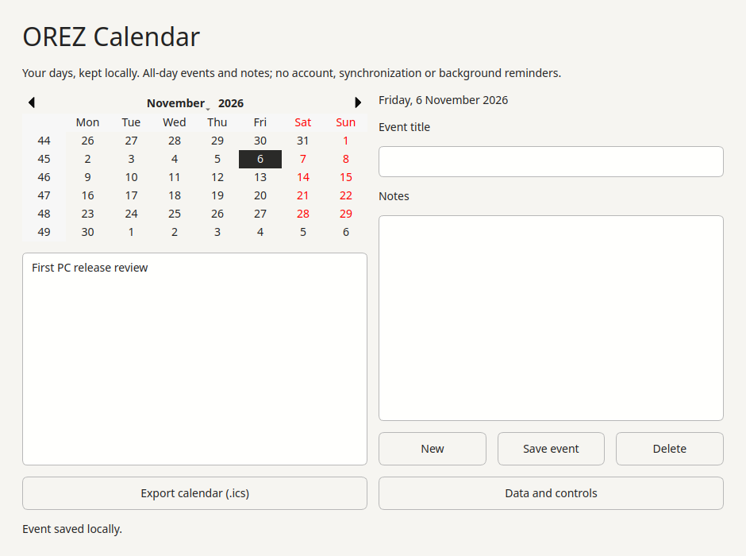
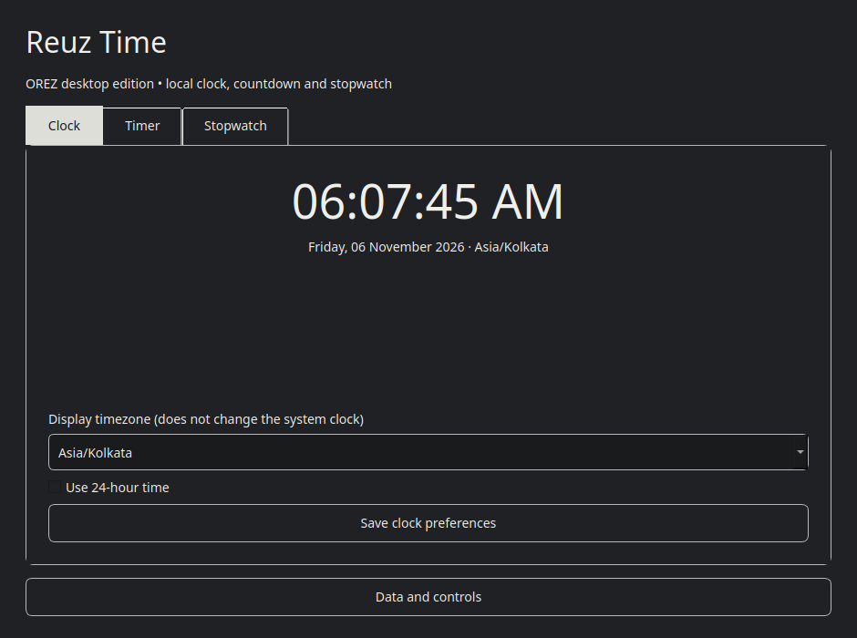

# Image application layer evidence — 6 November 2026

These are build/chroot/component results, **not** a full ISO boot, installed OS,
hardware certification or release download. See [IMAGE_APPLICATIONS.md](../../IMAGE_APPLICATIONS.md)
for the complete procedure and remaining gates. Exact commit, CI and screenshot
download are recorded in the latest [handoff](../../AI_HANDOFF.md).

[Download 99 original PNGs](https://github.com/RezoxNemesis/OREZ-OS/archive/d0dd6db403d2b62b5c6ff067dcab8636563ebb5d.zip),
verified against every original image hash. All 25 local attempts and six failures
are represented (102 capture references; exact duplicates stored once).

[Final CI 42140670101](https://github.com/RezoxNemesis/OREZ-OS/actions/runs/42140670101)
passes on `f6c3df7`: decoded logs confirm 172 source tests, 38 package paths and
68 browser cases. Full ISO skipped. CI screenshots are separate in artifact
13468381144 (expires 20 November); metadata/logs verified, ZIP not downloaded.
The first run completed all checks and uploaded evidence but was canceled by its
12-minute deadline. Its annotation/logs remain in ci-attempt-1.json and the
excerpt. The follow-up's 18-minute bounded deadline passes. Its conditional
HTTPS preference for conventional source files did not affect this hosted
runner's indirect mirror list: final logs still show Azure HTTP. Faster setup
cannot be credited to that rewrite. APT signature checks remained on; no
authentication or sandbox bypass. See ci-final.json. The actual image package
resolver separately enforces HTTPS and its signed, scoped repository profile.

- Final authenticated download: qa9-10, 17 additions, 342,396,222 bytes; APT's
  `_apt` sandbox retained. `package-manifest.json` contains exact versions,
  origins, hashes, key pins and repository-index hashes. The large inherited
  package inventory is omitted from this small public evidence copy.
- Actual isolated offline installation: qa9-16. APT read-only dependency
  simulation followed by dpkg unpack/configure, without force flags. 2,283→2,300
  packages, zero existing upgrades/removals, clean dpkg audit.
- Original metadata: qa9-17. Seven actual base xattr paths identified directly
  from SquashFS pseudo metadata; no original attribute is shadowed by this delta.
- Packing and independent extraction: qa9-18. `packed-layer.json` records the
  383,488,000-byte artifact and 5,624 verified paths with exact data/metadata.
  Original ISO remains the lower layer; the stripped temporary root is never a
  complete replacement filesystem.
- Final native app checks: qa9-21, four scenarios. Three actual executable
  version records, Calendar SQLite save/reopen, Reuz timezone/format with
  Paper/Ink palettes, countdown pause/resume/completion and timer shutdown.
  The six PNGs are real Qt **offscreen** widget captures. `native-components.json`
  states UID/source hashes and limits. No physical input, sound or compositor
  tested. Brave wrapper/sandbox and game default data discovery remain separate.
- Final source regression: qa9-22, **172 tests pass**. Tests cover package trust,
  exact transitions, traversal, policy paths, set-ID/file capabilities and
  inherited-xattr protection in addition to the prior suite.
- Retention check: qa9-24 re-hashes the retained ISO/layer, verifies runtime
  tests left the persistent staged image unchanged, preserves the authenticated
  package pool, then removes only expanded task filesystems. About 13 GiB free
  space remains; both temporary containers are removed.
- Source/licence inventory: qa9-25 verifies 17 actual Debian control records and
  records source identities plus installed copyright metadata. Fifteen direct
  copyright records are present; aliases/missing entries need review. This is
  not complete licensing clearance, corresponding-source retention or an SBOM.
- Final vendor/owner policy audit: qa9-23, `security-audit.json`. No account or
  boot/auth/service-policy changes; no Brave management configuration or
  management privilege. Official Chromium sandbox helper remains `4755`;
  no runtime sandbox-enforcement pass is claimed. Cron exits immediately.

Failed attempts remain in the gallery: qa9-02 assumed modern Ubuntu source
layout (actual base uses sources.list); 04 used the wrong python-apt clear API;
11 used the wrong extraction exclusion switch; 13 hit APT's canonical local
archive filename issue before any persistent install change; 15 could not
`docker cp` through a read-only random-device bind; 19 found SuperTux's chroot
data discovery failure. Corrections are in source/fixtures and final checks.
The previous failed APT attempt was verified unchanged before retrying with
dpkg. No partial install was silently adopted as a new baseline.

qa9-05/08 completed downloads but emitted APT sandbox fallback warnings and are
**not** final sandbox qualification. qa9-10 fixes this with readable staging and
an `_apt`-owned temporary download directory. qa9-20's UI cases passed, but its
version parser initially recorded a Brave wrapper warning as the version; final
21 uses explicit executable launch and strict version matching. This caveat is
preserved rather than relabeling the old report as a stronger result.

qa9-07 is a runtime capability probe: chroot works, mknod is denied. Its success
means the probe ran, not that device creation is supported. qa9-09 verifies and
removes only the superseded generated cache-only ISO; `reclaimed-artifact.json`
records its identity. The original retained ISO and all prior screenshot bundles
are preserved. No physical disk, firmware, Windows USB, repository visibility
or owner account was changed.

